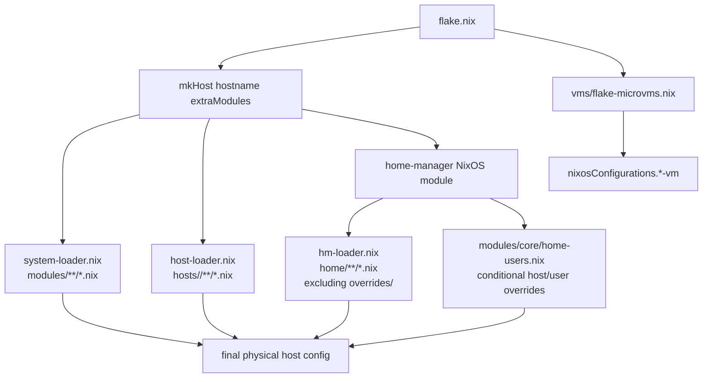
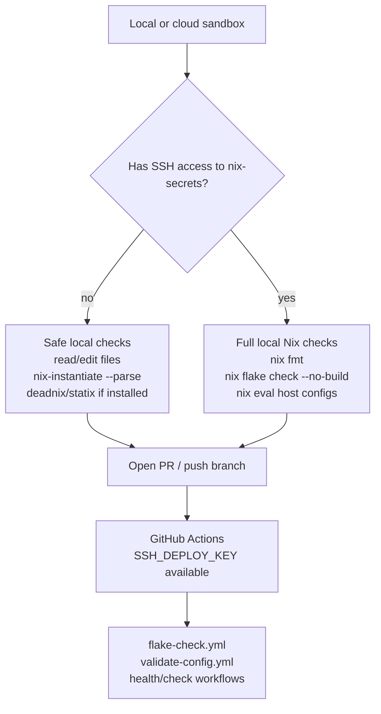

# Architecture Risks and Improvements

> **Original review: 2026-07-31; inventory and completed recommendations refreshed: 2026-11-22**

This report captures documentation drift, operational risks, and future
improvement opportunities discovered during a source-guided architecture
review.

______________________________________________________________________

## Executive summary

The repository has a strong modular foundation: loader-based imports,
role-based host composition, a clear `sys.*` / `hm.*` option split, conditional
SOPS declarations, and centralized MicroVM allocation data. The main risks are
not architectural collapse points; they are drift and validation gaps around
implicit conventions.

Most important follow-ups:

1. Keep registry and output validation aligned as new MicroVM allocation fields
   are introduced.
1. Keep the documented inventory aligned with declared outputs and explicit
   allocation exceptions.
1. Keep credential lifecycle guidance and private `VARS.users` validation
   aligned as the private schema evolves.

______________________________________________________________________

## Verified architecture strengths

- `flake.nix` is the single entry point for four physical hosts and the
  MicroVM outputs from `vms/flake-microvms.nix`.
- `system-loader.nix`, `host-loader.nix`, and `hm-loader.nix` remove most
  manual import bookkeeping.
- System options live under `sys.*`; Home Manager options live under `hm.*`.
- `modules/core/roles.nix` rejects simultaneous desktop and server roles with
  an assertion; another role-exclusivity mechanism is not currently needed.
- `modules/core/sops.nix` only declares service-specific secrets when their
  consumers are enabled, which avoids dangling SOPS requirements.
- `modules/virtualisation/microvm-base.nix` keeps VM lifecycle, host-owned
  network identity/lateral policy, transport-layer forwarding, and public HTTP
  publication distinct. Its policy compiler derives tap identities and gateway
  pairs from the registry, rejects invalid peer declarations, and has an
  executable spoofing, reachability, and bypass test. Publication still rejects
  duplicate forwarded ports and invalid or partial declarations, including
  disabled or unregistered targets, duplicate hostnames, unknown policies, and
  missing Cloudflare or Traefik adapters.
- Standard MicroVM publications render Cloudflare Tunnel and Traefik
  configuration from one instance-local intent, with mandatory CrowdSec and a
  closed set of route-scoped compatibility policies.
- `vms/vm-registry.nix` validates allocation uniqueness, IPv4 prefixes and
  gateways, effective tap IDs, dedicated bridges, and subnet overlap whenever
  the registry is imported.

______________________________________________________________________

## Repository evaluation flow

______________________________________________________________________

## Documentation drift

### MicroVM inventory and `flaresolverr`

The [MicroVM inventory](../vms/README.md#inventory) is the documentation source
for changing guest counts, allocation exceptions, and commands that inspect
the actual outputs. `vms/flake-microvms.nix` defines the buildable guests;
host-side instance configuration decides which guests run.

The extra `flaresolverr` registry entry is intentional: `vms/prowlarr.nix`
runs the service inside `prowlarr-vm` using its reserved registry port. The
standalone `vms/flaresolverr.nix` file is not wired as a guest output or host
instance. This is documented placement, not a missing deployment to repair.

### Stale architecture blueprint facts

The blueprint now links to the inventory instead of repeating guest counts.
Keep input aliases and selected output examples tied to `flake.nix`; examples
are not an exhaustive output or input inventory.

______________________________________________________________________

## Operational risks and improvements

| Area | Risk | Impact | Suggested improvement |
|------|------|--------|-----------------------|
| MicroVM registry | New allocation fields can outgrow the current validation contract | Invalid network allocations can break evaluation or activation | Extend `validate-vm-registry.nix` whenever the registry schema gains a new allocation field |
| Registry/output drift | Registry entries and VM files can diverge from `flake-microvms.nix` outputs | Docs and host enablement can point at non-existent VM outputs | Validate registry entries against wired outputs, with explicit exceptions |
| Role selection | New role bundles could outgrow the current exclusivity contract | Unsupported role combinations can conflict | Keep the assertion in `modules/core/roles.nix` aligned with supported roles; desktop/server overlap is already rejected |
| Home overrides | `modules/core/home-users.nix` uses `builtins.pathExists` for conditional override imports | The behavior is convenient but implicit | Keep the pattern documented and consider a lightweight override inventory check |
| `VARS.users` | `modules/core/users.nix` consumes fields from the private `VARS.users` data | Bad user registry data can lock out accounts on rebuild | Keep the explicit assertions for duplicate users/UIDs, placeholder password hashes, and malformed SSH public keys current with the private schema |
| CI host discovery | Workflows discover physical hosts with a grep for `name = mkHost` | Formatting or structure changes can drop a host from the matrix | Add a small host-discovery check or generate the matrix from Nix when feasible |

______________________________________________________________________

## Security and hardening risks

| Area | Risk | Current mitigation | Future improvement |
|------|------|--------------------|--------------------|
| Secret files | New credential formats may need additional exclusions | `.gitignore` already excludes `.env`, `.env.local`, `.env.*.local`, `*.key`, `*.pem`, and `*.crt`; `security-audit.yml` runs secret scanning | Review exclusions when adding a new local credential format |
| Publication compatibility policies | Some applications cannot use the strict security-header baseline unchanged | Compatibility exceptions are named, route-scoped, centrally mapped, and still include CrowdSec | Keep exceptions narrow and remove policies when workloads become compatible with `strict` |
| MicroVM lateral access | A compromised guest can originate arbitrary Ethernet frames on its tap | Registry-derived static FDB/neighbors and host-owned bridge/inet nftables policy enforce identity and declared paths; Blizzard is now configured in enforce after the recorded audit window | Review `lateral_drops` and retained counter snapshots after policy changes; use declarative `audit` rollback only while investigating |
| SOPS access | Missing host recipients cause activation/runtime failures for secret consumers | Private `nix-secrets` and CI deploy key keep secrets out of this repo | Keep `docs/sops-setup-guide.md` as the single source of truth for recipient setup |
| Log redaction | `.github/scripts/redact-secrets.sh` handles common token/key patterns | CI failure output is filtered before summaries | Periodically expand patterns for new token formats and environment names |

______________________________________________________________________

## Local versus CI validation

Do not work around private flake failures by changing the `nix-secrets` input,
inlining secrets, or committing generated secret material. CI is the source of
truth for full evaluation when a local environment lacks the deploy key.

______________________________________________________________________

## Recommended next code/config changes

These are intentionally not implemented in this documentation pass.

1. Extend credential lifecycle checks if private `vars.nix` metadata becomes
   mandatory instead of advisory.
1. Add a workflow or script check for host discovery and VM registry/output
   consistency, retaining the documented embedded-service exception.

______________________________________________________________________

## Source files reviewed

- [`flake.nix`](../flake.nix)
- [`system-loader.nix`](../system-loader.nix), [`host-loader.nix`](../host-loader.nix), [`hm-loader.nix`](../hm-loader.nix)
- [`modules/core/home-users.nix`](../modules/core/home-users.nix)
- [`modules/core/users.nix`](../modules/core/users.nix)
- [`modules/core/roles.nix`](../modules/core/roles.nix)
- [`modules/core/sops.nix`](../modules/core/sops.nix)
- [`modules/virtualisation/microvm-base.nix`](../modules/virtualisation/microvm-base.nix)
- [`vms/vm-registry.nix`](../vms/vm-registry.nix)
- [`vms/flake-microvms.nix`](../vms/flake-microvms.nix)
- [`vms/prowlarr.nix`](../vms/prowlarr.nix)
- [`vms/flaresolverr.nix`](../vms/flaresolverr.nix)
- [`hosts/blizzard/virtualisation/microvms.nix`](../hosts/blizzard/virtualisation/microvms.nix)
- [`hosts/blizzard/security/traefik.nix`](../hosts/blizzard/security/traefik.nix)
- [`hosts/blizzard/services/cloudflared.nix`](../hosts/blizzard/services/cloudflared.nix)
- [`lib/traefik.nix`](../lib/traefik.nix)
- [`tests/microvm-publication.nix`](../tests/microvm-publication.nix)
- [`treefmt.nix`](../treefmt.nix)
- [`.github/workflows/flake-check.yml`](../.github/workflows/flake-check.yml)
- [`.github/workflows/validate-config.yml`](../.github/workflows/validate-config.yml)
- [`.github/workflows/copilot-auto-merge.yml`](../.github/workflows/copilot-auto-merge.yml)
- [`.github/scripts/redact-secrets.sh`](../.github/scripts/redact-secrets.sh)
