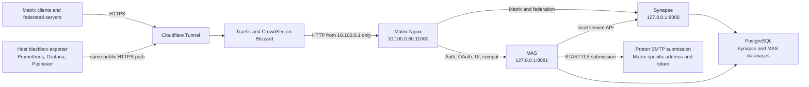

# Matrix hardening plan

This is the resumable implementation handoff for hardening the bespoke Matrix
deployment before adding Pocket ID as an upstream identity provider. It records
approved design decisions; it does not authorize a deployment, secret change,
network-policy transition, or OIDC cutover.

The separate [service mail architecture](service-mail-architecture.md) defines
the Proton Mail and SimpleLogin boundary used by Matrix and other services. The
existing [Pocket ID migration plan](pocket-id-migration-plan.md) remains the
authority for the later OIDC migration.

## Resume here

| Field | Value |
| --- | --- |
| Repository anchor | `60c86651f483cce78fb3b40714fb9e2655f07850` |
| Source review | 2026-08-13 |
| Current roadmap branch | `main` (Matrix baseline implementation merged) |
| Overall status | R-03 Done on 2026-10-12: runtime acceptance complete on operator evidence; operator approved closure and waived the remaining seven-day baseline observation |
| Last verified | Repository source, upstream documentation, and read-only public-path probes on 2026-08-14; operator-supplied client-IP fix retest and post-deployment login/QR confirmation on 2026-10-11, and SMTP-outage/recovery confirmation on 2026-10-12, supplement the earlier acceptance evidence below |
| Next action | No R-03 closure work remains. Matrix offsite backup/restore is optional under R-04; any bridge or OIDC activation follows its own remaining acceptance and authorization requirements |

On 2026-08-14, a read-only smoke check through the public path returned HTTP
200 for the Matrix client versions endpoint, MAS/OIDC discovery, root-domain
federation discovery, and the federation API version endpoint. Their required
`versions`, `issuer`, `m.server`, and `server` fields matched the configured
contracts. This is partial availability evidence from one operator vantage
point, not acceptance evidence for login, recovery, clients, federation
messaging, raw-port rejection, URL-preview isolation, restart/rotation
behavior, alert delivery, or the seven-day observation gate.

Before activation or further runtime work:

1. Treat the repository anchor above as the source-evidence baseline and review
   every intervening Matrix, MAS, Nginx, publication, backup, monitoring,
   mail, secret, and MicroVM network-policy change.
1. Confirm that the MicroVM network policy completed its explicitly approved
   audit gate, including any documented exception, was approved for `enforce`,
   and was merged.
1. Refresh all pinned-version claims against the current package sources and
   upstream primary documentation.
1. Stop if current evidence contradicts an invariant or acceptance gate below.

## Roadmap and change boundaries

The work is intentionally split so that failures and rollbacks have one clear
cause.

| Order | Change set | Runtime scope | Completion gate |
| --- | --- | --- | --- |
| 1 | MicroVM network hardening | Merged prerequisite; retain its live audit and enforcement evidence | Approved audit gate, every event investigated, explicit approval, `enforce` deployed, then merge |
| 2 | Matrix baseline hardening | Merged publication, listener, routing, authentication, systemd-hardening, and probe implementation | Done on 2026-10-12; live acceptance passed on operator evidence and the operator waived the remaining baseline observation |
| Optional | Reusable MicroVM offsite backup | Extract the Immich pattern and add an isolated Matrix backup if prioritized | First backup and isolated restore establish recovery if pursued; this is not a bridge or OIDC prerequisite |
| 3 | Pocket ID OIDC migration | Dedicated Pocket ID client and MAS upstream provider | Follow the provider recovery and service gates in the Pocket ID migration plan, with Matrix last; R-04 is optional |

The service-mail document and other planning work may proceed in parallel
because documentation does not alter the runtime. Runtime work must retain the
sequence above.

The planned WhatsApp bridge is tracked separately in the
[Matrix–WhatsApp bridge design](matrix-whatsapp-bridge.md). Its R-03 prerequisite
is complete. Matrix backup/restore, including linked-device state, is optional
by the operator's 2026-10-12 decision. Private secrets, live bridge checks, and
activation approval remain required; document how to re-login if state is lost.

## Verified current state

The statements in this section are source observations, not claims about the
currently deployed generation.

| Area | Repository evidence | Consequence |
| --- | --- | --- |
| Workload boundary | [`vms/matrix-synapse.nix`](../vms/matrix-synapse.nix) runs Synapse, MAS, Nginx, and one PostgreSQL service with separate Synapse and MAS databases in one MicroVM | The approved target keeps this single-VM boundary |
| Durable state | The VM declares Synapse, PostgreSQL, and MAS images; [`mkMicrovmConfig.nix`](../vms/mkMicrovmConfig.nix) adds `persist.img`; enabling the bridge adds `mautrix-whatsapp-state.img` | A consistent offsite backup must include the four baseline images, or all five images when the bridge is enabled, from one snapshot |
| Managed publication | [`hosts/blizzard/virtualisation/microvms.nix`](../hosts/blizzard/virtualisation/microvms.nix) publishes `matrix.<domain>` through the standard Cloudflare Tunnel, Traefik, and CrowdSec path | This becomes the only public workload path |
| Raw publication | The Matrix instance declares no host TCP `11060` port-forward | The managed HTTP publication is the only public workload path |
| Guest ingress | Nginx binds `0.0.0.0:11060`, and the guest firewall accepts only the primary guest interface and Blizzard's `10.100.0.1` gateway | Nginx is reachable only through the managed host publication path |
| Internal listeners | MAS web and health, plus Synapse, bind to loopback; MAS trusts only `127.0.0.1/32` | Nginx is the only trusted MAS proxy and no Matrix backend has a guest-network listener |
| Routing | Nginx path-routes MAS compatibility/OIDC/UI endpoints and otherwise sends requests to Synapse | Nginx remains the deliberate compatibility router; it is not replaced by Traefik |
| Admin API | The Nginx route returns `403` for `/_synapse/admin` before the Synapse catch-all | Retain required client endpoints such as `/_synapse/client/rendezvous` |
| MAS GraphQL | `/graphql` is routed to MAS's frontend API, not the separately controlled MAS Admin API | Preserve the frontend API route without treating it as an administrative exposure |
| CORS | The hostname-wide Traefik wildcard CORS header is removed; Nginx retains explicit CORS only on Matrix well-known responses | Keep discovery CORS narrow and do not add it to token-bearing API routes |
| Registration | MAS sets `password_registration_enabled = false`, and the evaluated Synapse config also disables registration | New password registration is closed before OIDC work |
| Recovery | MAS has SMTP configured and explicitly sets `password_recovery_enabled = true` | Recovery remains available for retained password accounts, subject to live acceptance testing |
| Mail ownership | Only MAS consumes the dedicated `matrix-authentication-service/smtp_token`; Synapse has no SMTP configuration or access to that token | MAS is the sole Matrix mail sender; preserve the dedicated secret and its access restrictions |
| Client compatibility | MAS dynamic client registration allows host mismatch and rejects insecure URIs; Synapse enables MSC4108 rendezvous | Preserve these settings until Element X login, refresh, logout, and QR linking pass |
| Media and previews | Synapse permits 90 MB uploads and enables URL previews with private, loopback, link-local, documentation, benchmark, multicast, and other special-use ranges blacklisted | Validate both the near-limit media path and the public-versus-private preview boundary |
| Federation | Synapse serves federation resources and root-domain discovery delegates to `matrix.<domain>:443` | Federation remains enabled and is part of health and acceptance testing |
| Calls | No TURN or MatrixRTC service is configured | Reliable cross-network voice and video are not promised by the baseline |
| Local recovery | Recursive Sanoid snapshots cover the VM state dataset | Local snapshots reduce recovery time; offsite Matrix recovery is optional under R-04 |
| Offsite recovery | A dedicated `matrix-rsyncnet` Borg job is declared in [`backup.nix`](../hosts/blizzard/services/backup.nix), with a [Matrix restore runbook](matrix-backup.md) | R-04 remains optional; source wiring does not prove credential provisioning, repository operation, or an isolated restore |
| Monitoring | Blizzard declares four [public Matrix probes](../hosts/blizzard/monitoring/blackbox.nix) for client API, OIDC discovery, federation discovery, and federation API, with Prometheus, Grafana, and Pushover alert wiring; MAS health remains loopback-only | Preserve public-path availability checks; source declarations alone do not establish live probes or alert delivery |
| Runtime secret assembly | `sops-install-secrets.service` feeds `matrix-synapse-secret.service` and `mas-secret.service`; the generators write `/run/matrix-synapse-secret/shared-secret.yaml` and `/run/mas-secret/config.json` | Keep decrypted values out of the Nix-generated base configuration and verify the generator/consumer restart sequence during rotation |
| Service sandbox | PR #6581 hardens `matrix-authentication-service.service`, `mas-db-init.service`, `matrix-synapse-secret.service`, and `mas-secret.service` with restricted capabilities, namespaces, system paths, address families, and declared read/write paths | Preserve the declared filesystem and network boundaries while completing live compatibility checks |

## Approved target architecture



Security invariants:

- The public workload has one path: Cloudflare Tunnel to Traefik/CrowdSec to
  Nginx. TCP `11060` is not forwarded from Blizzard's external interfaces.
- Nginx is the only Matrix guest service reachable from the MicroVM network.
  Only Blizzard's gateway address may connect to it.
- Synapse, MAS web, and MAS health listeners are loopback-only. Only Nginx is a
  trusted MAS proxy.
- Nginx remains because the operator's earlier Traefik-only routing attempt did
  not work reliably. Replacing it is outside this plan.
- Synapse's public Admin API is denied. Administration uses SSH and a local
  loopback request path.
- MAS owns password login, recovery, account management, and all Matrix email.
  Synapse does not retain unused SMTP credentials.
- SOPS secret files are read by dedicated one-shot generator units. The Synapse
  generator writes only `/run/matrix-synapse-secret`, the MAS generator writes
  only `/run/mas-secret`, and the long-running MAS service writes durable state
  only under `/var/lib/mas`.
- New password registration is disabled. Existing password login and tested
  email recovery remain available through the baseline and initial OIDC
  linking period.
- Federation remains enabled. The baseline does not introduce TURN, MatrixRTC,
  or tracing.

## Work package A: Matrix baseline hardening

The checked items below are declarative source or evaluation-test changes. Items
that require deployment, live traffic, or retained-account inventory remain
unchecked until those acceptance gates are completed.

### Publication and guest ingress

- [x] Remove the Matrix `portForwards` entry for TCP `11060`.
- [x] Keep the standard `matrix` MicroVM publication and the bespoke
  root-domain Matrix discovery router.
- [x] Add an evaluation or integration check proving the Matrix publication is
  enabled without a raw forward.
- [x] Restrict the guest firewall so TCP `11060` accepts only source
  `10.100.0.1`. Reject other reachable MicroVM and routed sources.
- [x] Keep Nginx on `0.0.0.0:11060`; it is the intentional guest network
  boundary.
- [x] Bind Synapse to `127.0.0.1:8008` and correct the stale listener comment.
- [x] Keep MAS web and health listeners on loopback and narrow
  `trusted_proxies` to loopback.
- [x] Assert or test that no other Matrix process has a non-loopback listening
  socket.

### Nginx route contract

- [x] Keep explicit MAS compatibility routing for versioned Matrix
  login/logout/refresh endpoints.
- [x] Keep the MAS discovery, OAuth, account, human UI, assets, JWKS, GraphQL,
  and upstream-provider routes required by the installed MAS version.
- [x] Correct the `/graphql` comment: the route is used by MAS's frontend, not
  the separately controlled MAS Admin API.
- [x] Return a denial for `/_synapse/admin` before the Synapse catch-all.
- [x] Preserve `/_matrix`, federation, media, and
  `/_synapse/client/rendezvous` behavior.
- [x] Preserve the root-domain `/.well-known/matrix/server`,
  `/.well-known/matrix/client`, and `/.well-known/matrix/support` responses.
- [x] Add route-contract tests that identify the selected upstream or expected
  denial for every canonical path. The focused check renders the generated
  Nginx configuration and probes it with stub MAS and Synapse upstreams;
  shared contracts cover exact, prefix, regex, suffix, and near-miss paths.

### CORS and proxy headers

- [x] Remove wildcard CORS from the hostname-wide Traefik Matrix middleware.
- [x] Let Synapse and MAS emit CORS for their own application endpoints.
- [x] Retain explicit wildcard CORS on the public Matrix well-known discovery
  responses.
- [x] Preserve security headers that do not conflict with Matrix clients.
- [x] Resolve the original client address through only the known proxies,
  replace the incoming forwarding chain with that single address, and verify
  that fabricated headers cannot spoof the client address to the backends.
  The deployed shared Nginx policy covers MAS and Synapse; the public retest
  directly confirms Synapse attribution. Live MAS attribution was not visible
  in the captured logs, and remains an evidence limit rather than an independently
  verified claim.
- [x] Treat browser and native-client acceptance tests as the compatibility
  gate for the narrower policy.
  Operator-confirmed browser, Element Classic desktop/iOS, and Element X iOS
  login, messaging, media, and QR flows provide the recorded compatibility
  evidence. Ordinary login and QR login were also operator-confirmed after
  deployment of the client-IP correction on 2026-10-11.

### Registration, passwords, recovery, and mail

- [x] Set MAS `account.password_registration_enabled = false`.
- [x] Keep the MAS password database enabled for existing users.
- [x] Set MAS `account.password_recovery_enabled = true`.
- [x] Inventory every retained account and confirm it has a controlled recovery
  address before deployment.
  The operator confirmed that all retained human accounts have confirmed
  recovery email addresses controlled by their owners on 2026-10-11.
- [x] Give MAS a permanent Matrix service address and unique Proton SMTP token
  as specified by the service-mail architecture.
  Source wiring uses `matrix@<public-domain>` and the dedicated MAS SMTP SOPS
  input; the recorded rotation/recovery-mail test supplies runtime evidence.
- [x] Remove the Synapse email block, SMTP token reads, and access to the shared
  mail secret while notifications remain disabled.
  Source review and the assertions in `tests/matrix-baseline.nix` establish
  the declaration; this reconciliation does not claim a new evaluation run.
- [x] Keep the registration shared secret only for the reviewed local
  administrative workflow; do not expose it through a public registration
  path. The source retains the secret in the guest-local generator/consumer
  workflow; CLI provisioning and public administration denial have recorded
  operator evidence.
- [x] Send and complete a real recovery email for every retained account class.
  A successful SMTP connection or queued message is not sufficient.
  In addition to the administrator recovery result, the operator confirmed
  successful recovery for a regular non-administrator account on 2026-10-11.
- [x] Verify that losing SMTP does not break an existing password login or an
  already established Matrix session. The operator demonstrated blocked SMTP
  on 2026-10-12, working login/messaging during the outage, and completed
  recovery after restoration; see the evidence below.

### Client compatibility

- [x] Preserve MAS dynamic client registration.
- [x] Preserve `allow_host_mismatch = true` because Element X requires the
  current behavior; keep `allow_insecure_uris = false`.
- [x] Preserve Synapse MSC4108 rendezvous routing for QR device linking.
- [x] Test Element X login, token refresh, logout, and QR linking before and
  after a service restart.
- [x] Operator confirms successful QR login; the previously reported stall
  after the two-digit confirmation no longer occurs. The report does not
  establish a paired before/after service-restart test.
- [x] Record the installed MAS and Synapse versions with the acceptance
  evidence: MAS `1.26.0` and Synapse `1.162.0`, captured on 2026-10-11 below.
- [ ] Rerun the route contract after either package changes. The version
  capture is not evidence of a new route-contract evaluation or build.

### URL-preview boundary

- [x] Keep the explicit URL-preview IP blacklist at least as restrictive as
  the current configuration.
  Source reconciliation found the explicit IPv4/IPv6 special-use blacklist
  retained in `modules/services/matrix-synapse.nix`; no policy edit was made.
- [x] Test a normal public HTTPS preview.
- [x] Test loopback, the MicroVM bridge, RFC 1918, Tailscale, link-local, and an
  attacker-controlled public DNS name resolving to a private address. All must
  fail without making a backend request.
  Operator-supplied API responses and resolver-blocking logs on 2026-10-11
  establish rejection before connection for the tested literal and DNS-resolved
  addresses. The private-DNS test covers IPv4 MicroVM and IPv6 loopback answers;
  it does not exercise DNS answers changing during a request.
- [ ] Recheck the blacklist if an outbound HTTP proxy is ever introduced;
  Synapse documents different resolution behavior through a proxy.

### systemd hardening

- [x] Add compatibility-tested source sandboxing to
  `matrix-authentication-service.service`, `mas-db-init.service`,
  `mas-secret.service`, and `matrix-synapse-secret.service`. PR #6581 also
  added evaluation assertions for the shared hardening and runtime path
  contracts.
- [x] Use narrow filesystem writes, read-only secret bindings,
  `NoNewPrivileges`, private temporary state, protected system/home paths, and
  only the address families each unit needs. The generator units are restricted
  to local Unix sockets; MAS additionally needs IPv4 and IPv6 for SMTP and
  other service traffic.
- [x] Verify that a non-default
  `sys.services.matrix-authentication-service.runtimeConfigFile` remains
  compatible with the service sandbox. The module derives the runtime file's
  parent directory, and the VM's secret generator writes through the same
  option. The focused contract check extends the production Matrix VM and
  exercises `/run/mas-alternate/config.json`, while the deployed VM uses
  `/run/mas-secret/config.json`.
- [x] Exercise SOPS rotation end to end: re-materialize the changed secret,
  re-run both generator units as applicable, restart their consumers, and prove
  that no stale runtime configuration remains. Both generators are
  `Type=oneshot` with `RemainAfterExit=true`, so a successful initial boot is
  not rotation evidence.
  Operator-supplied verification on 2026-10-11 proves both generated runtime
  files match the replacement SOPS inputs, successful generator/consumer
  restarts, and working authentication, messaging, and recovery mail. The old
  SMTP token was revoked when its replacement was created; see the evidence below.
- [x] Record the current `systemd-analyze security` inventory, but use
  the full acceptance matrix—not the numeric score—as the deployment gate.
  Every directive must preserve database migrations, runtime config generation,
  email, dynamic client registration, and client flows.
  Current scores and active hardening were captured on 2026-10-11 below; no
  pre-deployment score was supplied, so a historical comparison is unavailable.

### Availability monitoring

The host-side module and initial Matrix registrations are present in `main` from
the follow-up observability PR. Its public interface is a declarative target
list; exporter configuration, relabeling, common alerts, and dashboard labels
remain internal. Matrix is still the only initial service target. Add other
services in later, independently reviewable changes.

Primary probes must traverse public DNS, Cloudflare Tunnel, Traefik/CrowdSec,
Nginx, and the target service:

- [x] Matrix client API: a public `/_matrix/client/versions` request with JSON
  validation.
- [x] MAS/OIDC discovery: the public
  `/.well-known/openid-configuration` response, including issuer validation.
- [x] Federation discovery: the public root-domain
  `/.well-known/matrix/server` response and its delegated Matrix endpoint.
- [x] Federation API version: the public
  `/_matrix/federation/v1/version` response with native JSON validation.

Internal diagnostics may probe Nginx, Synapse loopback, and MAS `/health`, but
must not replace the public availability signal.

- [x] Export probe success, duration, HTTP/TLS status, and certificate-expiry
  metrics to the existing Blizzard Prometheus.
- [x] Provision a shared service-availability Grafana dashboard from the repo.
- [x] Alert only after a nonzero sustained-failure window; the current
  implementation uses five minutes with a 30-second scrape cadence.
- [x] Route firing and resolved states through the existing Grafana Pushover
  contact point.
- [x] Force a public-probe failure and prove one firing and one resolved
  Pushover notification (operator-confirmed on 2026-10-11).
- [x] Confirm the effective pending duration against the configured five-minute
  window (explicitly operator-confirmed on 2026-10-11). The exact alert identity
  and notification timestamps were not supplied; see the evidence below.
- [x] Do not add distributed tracing in this work package.

## Baseline acceptance matrix

All items are live runtime gates. A build, evaluation, unit test, or source
inspection cannot mark them complete.

| Capability | Required evidence |
| --- | --- |
| Existing login | Existing password user logs in through the public hostname; session survives a normal service restart |
| Recovery | A real MAS recovery email arrives, its link completes a password reset, and the new password logs in |
| Closed registration | Anonymous new password signup is rejected while the reviewed administrative registration path remains local |
| Element X | Login, refresh, logout, and QR device linking work through the public hostname |
| Local encrypted messaging | Two local accounts exchange encrypted messages and recover history on a verified second device |
| Federation | Encrypted messages and media travel in both directions with an external homeserver; external discovery resolves the delegated server |
| Media | A file near the configured 90 MB limit uploads and downloads through the managed public path |
| URL preview | A public URL previews; private, loopback, MicroVM, and rebinding-style targets are blocked |
| Admin denial | Public `/_synapse/admin` requests are denied; local SSH/loopback administration still works |
| Raw-path removal | External, LAN, Tailscale, and peer-MicroVM attempts to reach raw TCP `11060` fail; Traefik can still reach Nginx |
| CORS | Matrix well-known discovery works cross-origin; Synapse, MAS, Element X, and browser flows work without hostname-wide wildcard injection |
| Observability | Public probes populate Prometheus and Grafana; a forced sustained failure fires and later resolves Pushover |
| Restart behavior | Nginx, Synapse, MAS, PostgreSQL, secret generators, and probes recover cleanly after the planned restart sequence; a SOPS rotation proves new runtime material is consumed |

### Operator-reported recovery, QR login, and SMTP rotation evidence

The following results were recorded on 2026-10-11 from the operator's
acceptance reports. They are live operator-reported results, not an independent
agent audit. The rotation test has an exact UTC start time and deployed system
path below; exact times and client/server versions for the earlier recovery and
QR tests were not captured.

| Check | Recorded result |
| --- | --- |
| Password recovery | The recovery email arrived and the password reset completed. The new password worked and the old password failed. Existing sessions remained logged in, and old messages/history remained decryptable. On 2026-10-11, the operator additionally confirmed regular non-administrator recovery and that every retained human account has a confirmed recovery email controlled by its owner. |
| QR login | The operator subsequently confirmed that QR login works. The earlier flow scanned the QR and completed a two-digit confirmation but stalled at a browser prompt for a six-digit code. That symptom is no longer reported; the cause and any corrective change were not supplied. |
| MAS SMTP-token rotation | The operator rotated `matrix-authentication-service/smtp_token`, revoked the old Proton token when creating its replacement, rebuilt the VM, and successfully received recovery mail. Runtime comparison also confirmed MAS's generated SMTP password matches the current SOPS input. |
| MAS–Synapse shared-secret rotation | The operator replaced `matrix-authentication-service/synapse_secret`, then completed the coordinated SOPS, generator, and consumer restart verification below. Both generated shared-secret fields matched the current SOPS input, and the operator confirmed fresh browser login, encrypted messaging, Element X sync/send, and recovery-mail delivery afterward. |

The coordinated verification began at **2026-10-11T11:55:11Z** on:

```text
/nix/store/1pza7vv2mrsw7lmgzq9bd7qk4czriznp-nixos-system-matrix-synapse-vm-26.05.20261009.f584496
```

The operator ran the sequence inside the Matrix guest: stop MAS and Synapse,
restart SOPS materialization, restart both generators, compare the generated
fields against the current SOPS files without printing their values, and start
both consumers. All three comparisons passed: Synapse's shared secret, MAS's
shared secret, and MAS's SMTP token.

| Unit / artifact | Captured result (UTC, 2026-10-11) |
| --- | --- |
| `matrix-synapse-secret.service` | Started 11:55:11; active 11:55:12; `Result=success` |
| `mas-secret.service` | Started and active 11:55:12; `Result=success` |
| `/run/matrix-synapse-secret/shared-secret.yaml` | Modified 11:55:12.037498054; owner/group `matrix-synapse:matrix-synapse`; mode `0440` |
| `/run/mas-secret/config.json` | Modified 11:55:12.152629804; owner/group `mas:mas`; mode `0440` |
| `matrix-authentication-service.service` | Started and active 11:55:12; `Result=success` |
| `matrix-synapse.service` | Started 11:55:16; active 11:55:19; `Result=success` |

All four units reported `active`. The ordered sequence, fresh runtime files,
matching replacement credentials, and successful functional tests close the
secret-rotation gate for these representative SMTP and shared-secret paths.
This does not require or claim rotation of MAS encryption/signing keys.

The initial public client-versions command omitted the pipe before `jq` and
ended with `curl: (6) Could not resolve host: jq`. The operator corrected and
reran it on 2026-10-11:

```console
curl -fsS https://matrix.zzxyz.no/_matrix/client/versions | jq -e '.versions | length > 0'
true
```

The corrected run confirms public API availability and a passing assertion
that the response contains a nonempty `versions` array.

These rotation results contribute to the accepted baseline. Security-boundary,
URL-preview, alert-delivery, client-IP, and SMTP-outage evidence are recorded
separately below. The later closure decision waives the baseline observation.

### Operator-reported security-boundary evidence

The operator supplied command output and follow-up results in the R-03
acceptance conversation. These are live operator-reported results, not an
independent agent audit. The deployed generation and exact tailnet policy
revision were not captured with these tests.

| Check | Recorded result |
| --- | --- |
| Public client API | `https://matrix.zzxyz.no/_matrix/client/versions` returned `200` from Snowfall, including after the tailnet policy change. |
| Public Admin API denial | `/_synapse/admin/v1/server_version` returned `403` through the public hostname and directly through guest Nginx from Blizzard. |
| Host raw port | Snowfall connections to Blizzard's LAN `192.168.2.100:11060` and Tailscale `100.85.254.99:11060` timed out. |
| Snowfall direct guest access | Initially succeeded through Tailscale; bridge capture showed source `10.100.0.1`, matching the guest's trusted gateway. After removing the explicit Snowfall/iPhone Matrix grant and deploying the policy, `10.100.0.60:11060` timed out while the public client API remained healthy. |
| iPhone direct guest access | With Wi-Fi disabled and Tailscale connected over mobile data, the direct Matrix URL failed, the public client API worked, and an allowed guest service worked as the subnet-routing control. |
| Allowed Blizzard path | Blizzard's request to `http://10.100.0.60:11060/_matrix/client/versions` returned `200`. |
| Backend isolation and local administration | Snowfall connections to guest ports `8008`, `8081`, and `8082` timed out. Guest `ss -lnt` showed those listeners on `127.0.0.1`; a loopback Synapse Admin API request returned server-version JSON. |
| Peer-MicroVM path | From `gitea-vm`, a request to `http://10.100.0.60:11060/_matrix/client/versions` failed with curl exit `7` after about three seconds. The public client API succeeded and returned a valid `versions` array from the same VM. |
| LAN path without Tailscale | At `2026-10-11T18:16:49Z`, Snowfall's route to `10.100.0.60` used `192.168.2.1`, physical interface `enp5s0`, and source `192.168.2.101`. The direct TCP `11060` request timed out with curl exit `28`; the public client API succeeded with exit `0`. This proves endpoint unreachability over that LAN path, not that the router forwarded the request to the guest firewall. |
| Work-client path | After the instructed narrowed-grant deployment and Tailscale-connected work-client test, the operator confirmed both expected outcomes: direct guest TCP `11060` access failed and the public client API returned the expected JSON. Command output and the exact deployed policy revision were not retained. |
| External IPv4 | The UDM SE reported CGNAT. WAN address `100.67.198.219` is not a public origin address; its timeout is not evidence of an origin firewall denial. No publicly routable IPv4 origin was identified. |
| External IPv6, tested address | Windows PowerShell could route to Blizzard's `2a01:799:1a5c:c701:3e7c:3fff:fe18:3028`, but TCP `11060` failed. A Cloudflare IPv6 request confirmed working IPv6 on Windows. The operator then repeated the test through the iPhone's mobile-data hotspot and reported the same connection failure with a different source address, establishing an outside-home vantage for the denial. The hotspot output and a separate hotspot IPv6 control were not supplied. |

The WSL attempts returned `Network is unreachable` and are not firewall-denial
evidence. The earlier Windows Wi-Fi test alone did not establish an external
vantage; the mobile-hotspot repeat supplies that distinction.

The remaining external IPv6 test output was subsequently supplied at
**2026-10-11T18:29:31Z**, following the outside-home mobile-hotspot procedure
with Tailscale disconnected. The explicit IPv6 Cloudflare control returned
HTTP `200`. Requests to TCP `11060` on all three addresses in the supplied
Blizzard interface inventory timed out with curl exit `28` after about five
seconds each:

- `2a01:799:1a5c:c701:5b33:e888:2e60:7920` (temporary);
- `2a01:799:1a5c:c701:bf73:f19c:4075:f379` (temporary, deprecated);
- `2a01:799:1a5c:c701:3e7c:3fff:fe18:3028` (stable interface address).

The public Matrix client API returned a valid `versions` array with curl exit
`0` during the same test. Temporary IPv6 addresses may subsequently change;
this evidence applies to the addresses present in that inventory and test.

The peer-MicroVM, LAN-without-Tailscale, external IPv6, and work-client gaps are
now operator-confirmed complete. Together with the earlier results, these
close the recorded raw-path reachability checks for the tested vantages.
Connection failures do not identify which router or firewall layer rejected a
request, and CGNAT leaves no public IPv4 origin to test. The seven-day
observation was later waived in the closure decision; secret rotation,
planned URL-preview isolation, and alert timing have separate evidence.

### Operator-reported URL-preview evidence

On 2026-10-11, the operator called the authenticated
`/_matrix/client/v1/media/preview_url` endpoint through the public Matrix
hostname. Each final test URL included a unique `r03_check` query parameter to
avoid reusing Synapse's earlier cached preview results. No access token is
recorded here. These are operator-supplied live results, not an independent
agent audit or a backend packet capture.

| Check | Recorded result |
| --- | --- |
| Public HTTPS control | `https://www.python.org/` returned HTTP `200` with Python.org OpenGraph metadata and an image stored as an `mxc://zzxyz.no/` URI. Two fresh public-control runs succeeded. |
| IPv4 loopback | `http://127.0.0.1:8008/_matrix/client/versions` returned HTTP `403`, `M_UNKNOWN`, and `IP address blocked`. |
| MicroVM bridge | `http://10.100.0.60:11060/_matrix/client/versions` returned the same explicit HTTP `403` IP-policy rejection. |
| LAN, Tailscale, and link-local | Requests targeting `192.168.2.100:8765`, `100.85.254.99:8765`, and `169.254.1.1:8765` returned the same explicit HTTP `403` IP-policy rejection. |
| Hostname resolving to private IPv4 | Guest DNS returned `10.100.0.60` for `r03-private.zzxyz.no`. Synapse logged `Blocked 10.100.0.60 from DNS resolution to r03-private.zzxyz.no` before returning HTTP `502`. |
| Hostname resolving to IPv6 loopback | Guest DNS returned `::1` for `r03-loopback6.zzxyz.no`. Synapse logged `Blocked ::1 from DNS resolution to r03-loopback6.zzxyz.no` before returning HTTP `502`. |

Both hostname-blocking records were captured at **2026-10-11 15:53:45** in the
guest journal's displayed time; that journal excerpt did not include a timezone.
These two `502` responses reflect deliberate filtering of the resolved private
addresses, leaving no permitted address to connect to. They are not evidence of
an unavailable DNS server. Together with the public control and literal IPv4
rejections, the results satisfy the planned public-preview and private-address
isolation checks, including a controlled public DNS name resolving to a private
address. No changing-answer or mid-request DNS-rebinding test was performed.

Two separate follow-ups remain recorded without claiming they were fixed:

- Literal `http://[::1]:8008/` requests returned HTTP `500` with an IDNA
  `InvalidCodepoint` error. This demonstrates a URL-parsing failure, not
  blacklist enforcement; the hostname-to-`::1` test establishes IPv6 loopback
  address filtering independently.
- Earlier public previews returned HTTP `502` with DNS-resolution failures.
  A separate Python lookup under Synapse's user also intermittently failed.
  The guest resolver reported 5,977 cumulative timeouts, used `1.1.1.1` on
  `microvm0`, and later resolved both public sites successfully. The cause and
  timeout interval were not established; successful final previews do not
  prove this reliability issue was repaired.

### Operator-reported alert-delivery evidence

On 2026-10-11, the operator stopped Nginx inside the Matrix guest, received a
firing notification, restarted Nginx, and subsequently confirmed receipt of
both firing and resolved Pushover notifications. The supplied Grafana dashboard
screenshots showed public probe success falling from `1` to `0` with HTTP `502`,
then returning to `1` with HTTP `200` after recovery. This establishes
operator-reported failure/recovery detection and notification delivery.

The charts show an outage of approximately 13:25 to 13:28 in the dashboard's
displayed timezone, shorter than the configured five-minute pending window.
The notification's alert name, exact delivery times, effective live rule
settings, dashboard timezone, and deployed generation were not supplied.
The operator subsequently explicitly confirmed the configured sustained-failure
timing on 2026-10-11 and stated certainty in that result. Accept this as
operator-confirmed completion of the timing check alongside the firing and
resolved delivery checks; no repeat test is required on the basis of the earlier
chart alone. The exact alert identity, notification timestamps, and effective
rule dump were not retained, so this is not an independently reconstructed
timeline. The baseline observation was later waived in the closure decision.

### Operator-reported version and sandbox inventory

The operator supplied `matrix-final-result.log` with a capture time of
**2026-10-11T21:19:30Z**. Both Synapse and MAS were active. Their service
executable paths identify **Synapse 1.162.0** and **MAS 1.26.0**, running under
the previously recorded Matrix guest system generation:

```text
/nix/store/1pza7vv2mrsw7lmgzq9bd7qk4czriznp-nixos-system-matrix-synapse-vm-26.05.20261009.f584496
```

The current `systemd-analyze security` output reported:

| Unit | Exposure score | Tool classification |
| --- | --- | --- |
| `matrix-authentication-service.service` | 3.0 | OK |
| `mas-db-init.service` | 2.8 | OK |
| `mas-secret.service` | 2.8 | OK |
| `matrix-synapse-secret.service` | 2.8 | OK |

The output confirms current controls including non-root service identities,
`NoNewPrivileges`, restricted capabilities, `ProtectSystem`, `ProtectHome`,
private temporary/device access, and restricted address families. The score is
a diagnostic inventory, not proof that every possible hardening directive is
appropriate or a substitute for the recorded functional acceptance tests. No
pre-deployment score was captured, and no new Nix route-contract check was run
as part of this inventory.

The subsequent guest capture establishes a client-IP spoofing failure:

- At `2026-10-11T21:24:26Z`, the ordinary request with marker
  `r03-client-ip-1791753866-ordinary` returned `200` and Synapse logged the actual
  caller, `84.234.219.121`.
- At `2026-10-11T21:25:20Z`, the request with marker
  `r03-client-ip-1791753920` supplied `X-Forwarded-For: 203.0.113.9` and
  `X-Real-IP: 198.51.100.9`. Both the client API and MAS login page returned
  `200`, but Synapse logged the injected `203.0.113.9`. MAS attribution was not
  established by the captured logs. The demonstrated impact is forged Synapse
  client-IP attribution; impact on IP-based controls remains unverified.

The deployed correction makes guest Nginx resolve `X-Forwarded-For` recursively
through only the Matrix gateway and host loopback proxy addresses, then replaces
the forwarding chain with `$remote_addr` on every Synapse/MAS proxy route. It
disables the per-location recommended header include to avoid retaining the
untrusted prefix or emitting duplicate forwarding headers. HTTPS forwarding,
WebSocket settings, discovery responses, administration denial, and rendezvous
ETag handling remain explicit.

Focused regression coverage includes ordinary IPv4 clients, fabricated prefixes,
IPv6 clients, untrusted peers, absent forwarding headers, and duplicate header
fields across the backend route contracts. Source evaluation and Nix parsing
passed; standalone Nginx reported valid configuration syntax, then failed when
the sandbox denied socket creation. The full `matrix-baseline` build was also
blocked by denied Nix-daemon access. A successful full regression-build result
was not supplied; the following operator-run public retest supplies live
evidence for the reported failure.

The updated guest capture at **2026-10-11T21:40:01Z** records this generation:

```text
/nix/store/fg150hxxz3mc6sd4h25q2ssxxdqbpax0-nixos-system-matrix-synapse-vm-26.05.20261010.6fcc160
```

Synapse and MAS remained active at versions 1.162.0 and 1.26.0. The two public
fabricated-header retests at **21:38:38Z** and **21:39:57Z**, with markers
`r03-client-ip-1791754717` and `r03-client-ip-1791754797`, returned `200` and
Synapse logged the real caller, `84.234.219.121`, instead of `203.0.113.9`.
This closes the demonstrated Synapse client-IP spoofing failure. The operator
also confirmed ordinary login and QR login after deployment. The source
applies the same canonical forwarding policy to MAS, but live MAS attribution
is not independently established by these logs.

### Operator-reported SMTP-loss tolerance

On **2026-10-12**, the operator ran the temporary SMTP-outage script inside
the Matrix guest. It inserted IPv4 and IPv6 OUTPUT rules rejecting TCP port
`587`, the configured Proton SMTP submission port, without changing credentials
or persistent firewall configuration. The test began at **08:47:11Z**.

| Check | Recorded result |
| --- | --- |
| SMTP outage demonstrated | The IPv4 rejection rule counted 4 packets / 260 bytes; the IPv6 rule counted 0 packets. At 08:53:51Z, MAS attempted recovery delivery and logged `Connection refused (os error 111)`. This demonstrates the tested IPv4 failure; it does not independently exercise IPv6 SMTP delivery. |
| Existing-session availability | The operator confirmed messages could be exchanged between sessions during the outage. |
| Fresh password login | The operator confirmed login continued working during the outage. |
| MAS availability | `ActiveState=active`, `MainPID=725`, `NRestarts=0` at the evidence capture. |
| Restoration | The script reported removal of its temporary SMTP rules. The operator then confirmed recovery-email delivery, completed password recovery, and successful new-password login after restoration. |

No email delivery during the rejection interval is expected. MAS logged
`Job completed` after the send error; this is not successful delivery evidence
and does not establish automatic retry. The post-restoration operator
confirmation supplies the delivery/recovery evidence. Exact restoration and
receipt timestamps were not retained. SMTP-loss tolerance is accepted for the
tested rejection failure; a prolonged blackhole/timeout outage was not tested.

### Baseline closure decision

- Baseline runtime acceptance is complete on the recorded operator evidence,
  including the deployed client-IP correction, post-deployment ordinary/QR
  login, and SMTP outage/restoration test. Historical sandbox comparison,
  missing MAS attribution logs, and the unavailable local full regression build
  retain their stated evidence limits; they are not claims of failed runtime
  acceptance. Future package/proxy changes still require the relevant rechecks.
- On **2026-10-12**, the operator explicitly instructed that R-03 be closed,
  citing longstanding operation without reported issues and Matrix's low
  priority. That instruction approves closure and waives the remaining
  seven-day post-acceptance observation; it does not establish a completed
  observation interval. R-03 is **Done**, with no remaining closure work.
- The operator also made Matrix offsite backup and restore a nice-to-have
  roadmap candidate under R-04. It is not a prerequisite for the bridge,
  Pocket ID foundation, or Matrix OIDC. Pocket ID's own recovery requirements
  and future service-specific acceptance and activation approvals still apply.

### Baseline rollback

- Keep the previous NixOS generation ready.
- If the managed route fails, roll back the baseline as one unit. Do not leave an
  undocumented imperative forward or broaden the guest firewall as a shortcut.
- If recovery email fails, keep existing password login available, roll back
  the recovery/mail changes, and rotate a token if exposure is suspected.
- If narrower CORS or route matching breaks a client, capture the exact request
  and response, then make the narrowest route-specific correction.
- For future changes with an observation window, a rollback or corrective
  deployment restarts that change's clock; it does not reopen the closed R-03.

## Seven-day baseline observation gate

The original plan required seven consecutive clean days after acceptance.
The operator waived the remaining window and approved R-03 closure on
**2026-10-12**. Retain the planned dates below as history, not an active gate
or proof of seven completed days.

The final SMTP restoration/recovery result was operator-confirmed on
2026-10-12. The documentation update time was recorded as a conservative
start after that confirmation:

| Observation field | Recorded value |
| --- | --- |
| Planned start | **2026-10-12T10:28:50Z** (12:28:50 CEST) |
| Original earliest completion review | **2026-10-19T10:28:50Z** (12:28:50 CEST), superseded by the waiver |
| Status | Waived by explicit operator instruction on 2026-10-12; the planned interval was not completed |
| Closure approval | Explicit operator approval on 2026-10-12; R-03 Done |
| Baseline generation | `/nix/store/fg150hxxz3mc6sd4h25q2ssxxdqbpax0-nixos-system-matrix-synapse-vm-26.05.20261010.6fcc160`, captured after the client-IP correction; no later deployment was reported |

Earlier uptime and the intentional acceptance-test outages do not establish
seven post-acceptance days. The closure decision accepts the recorded runtime
checks and operator-reported stable operation instead of requiring that wait.

For ongoing operation and future changes, continue reviewing:

- public Matrix, MAS/OIDC, and federation probes;
- Nginx, Synapse, MAS, and PostgreSQL restarts or failed units;
- password login, recovery, and SMTP failures;
- secret-generator completion, runtime-file freshness, and consumer restarts
  after any planned SOPS rotation;
- local and federated messaging or media failures;
- relevant `lateral_audit` or enforced MicroVM network-policy events;
- Grafana/Pushover alert firing and resolution behavior.

Any future observation requirement belongs to the relevant change. This
waiver does not remove future OIDC observation or activation requirements.

## Work package B: reusable MicroVM offsite backup

**Optional / nice to have:** on 2026-10-12 the operator moved R-04 to
Someday / Candidate. Matrix backup/restore does not block other roadmap work.
The source-side Matrix backup is declared alongside the existing Immich job,
but repository provisioning and restore verification remain uncompleted.
If this work is prioritized, move the common mechanism into a reusable module,
tentatively
`modules/virtualisation/microvm-offsite-backup.nix`.

### Module boundary

Expose a small `sys.virtualisation.microvm.offsiteBackup.jobs.<name>` interface
containing only caller-owned facts:

- logical MicroVM instance;
- authoritative volume contract;
- Borg repository and archive name;
- staggered schedule;
- SSH key, pinned known-hosts, and passphrase file paths;
- remote Borg executable and optional existing Pushover integration.

The module should derive and own:

- the `microvm@<name>-vm.service` relationship;
- the ZFS dataset, temporary snapshot name, and read-only image paths;
- credential ownership/mode preflight;
- repository preflight before stopping a VM;
- stop, snapshot, image validation, immediate restart, and active-state check;
- failure-safe VM restoration and snapshot cleanup;
- Borg/systemd ordering, hardening, persistent timer behavior, and failure
  notification.

Do not expose shell fragments as the caller interface.

### Immich migration and Matrix caller

- [ ] Move the existing Immich job onto the module without changing its
  repository, schedule, archive name, credentials, volumes, failure behavior,
  or runbook contract.
- [ ] Add focused evaluation/tests comparing the generated Immich job and its
  safety assertions before and after extraction.
- [x] Extract Matrix's volumes into an authoritative storage contract analogous
  to [`vms/immich-storage.nix`](../vms/immich-storage.nix).
- [x] Include `matrix-synapse-state.img`, `postgresql-state.img`,
  `mas-state.img`, and `persist.img` from the same stopped-VM ZFS snapshot.
- [x] When the WhatsApp bridge is enabled, include
  `mautrix-whatsapp-state.img` in that same snapshot. Its PostgreSQL database
  is already in `postgresql-state.img`; the generated registration under
  `/run` is rebuilt from the locked configuration and SOPS values.
- [x] Declare a separate Matrix Borg repository and encryption passphrase. Never
  share Immich backup credentials.
- [ ] Provision and verify the separate append-only forced-command SSH key.
- [x] Schedule Matrix daily at a different time from Immich. The accepted
  offsite recovery-point objective is at most 24 hours; local ZFS snapshots
  cover shorter recovery windows.
- [x] Add a Matrix backup and restore runbook. Do not put secret values in it.

### Restore gate

A Borg archive existing is not proof of recoverability.

- [ ] Restore the four baseline images from one archive into an isolated
  recovery location or disposable MicroVM environment. When the bridge is
  enabled, restore its fifth state image too. Do not loop-mount untrusted guest
  filesystems on Blizzard.
- [ ] Start the restored Matrix stack without publishing it to the production
  hostname or contacting production peers unexpectedly.
- [ ] Verify PostgreSQL, Synapse, MAS, local administrative access, existing
  password login, representative rooms/media, encryption keys, and the
  persisted SSH identity.
- [ ] When the bridge is enabled, verify the separate database, linked-device
  state, registration regeneration, and the documented re-login behavior if
  linked-device state is intentionally not restored.
- [ ] Record archive, date, duration, operator, result, and any manual steps.
- [ ] Repeat after a material storage/backup format change and at least every
  six months.

## Work package C: Pocket ID OIDC migration

OIDC remains a later PR and Matrix remains the last active service in the
Pocket ID rollout. Before starting it:

- [x] Close the Matrix baseline (R-03): operator-approved on 2026-10-12 with
  the remaining baseline observation waived.
- Matrix offsite backup and isolated restore are optional under R-04, not
  prerequisites for OIDC. Pocket ID's own backup/recovery gates still apply.
- [ ] Prove MAS recovery email and the global Pocket ID SMTP/recovery gates.
- [ ] Refresh both Pocket ID documents against the current repository and
  pinned service versions.
- [ ] Correct the migration plan's stale support-report digest: at the source
  snapshot used for this plan, the file hashes to
  `456037cc9d16de32f66b732a6995db3ecf22ca12fe527806d5870f0d51b1565a`,
  not the digest recorded in the plan. Recompute it again at implementation
  time rather than copying this value blindly.
- [ ] Complete and observe the earlier services in the approved migration
  order.

The later Matrix OIDC design must retain these approved invariants:

- one dedicated Pocket ID client and `oidc-matrix` admission group;
- one stable MAS upstream-provider ULID;
- explicit authenticated account linking, never automatic email adoption;
- lowercase Pocket ID username mapping to Matrix localpart;
- `on_conflict = fail`;
- existing passwords retained throughout linking, validation, recovery, and
  observation;
- password removal considered only in a later change with a fresh
  recommendation, explicit approval, and its own rollback evidence.

## Explicitly out of scope

- Replacing Nginx with Traefik path routing.
- Disabling federation.
- TURN or MatrixRTC deployment. Document reliable voice/video as unavailable
  until a separate network and abuse review approves the public relay ports,
  peer restrictions, quotas, monitoring, and secret handling.
- Distributed tracing.
- A central SMTP relay or shared Proton Bridge VM.
- `mautrix-whatsapp` runtime activation and linked-device credentials; see the
  separate [Matrix–WhatsApp bridge design](matrix-whatsapp-bridge.md).
- Pocket ID client, group, secret, or MAS upstream-provider creation in the
  baseline or backup PR.
- Automatic transition of the MicroVM network policy from `audit` to
  `enforce`.

## Primary upstream references

- [MAS reverse-proxy and compatibility routing](https://element-hq.github.io/matrix-authentication-service/setup/reverse-proxy.html)
- [MAS configuration reference](https://element-hq.github.io/matrix-authentication-service/reference/configuration.html)
- [Synapse Admin API exposure guidance](https://element-hq.github.io/synapse/latest/usage/administration/admin_api/)
- [Synapse installation security notes for URL previews and TURN](https://element-hq.github.io/synapse/latest/setup/installation.html)
- [Synapse TURN configuration](https://element-hq.github.io/synapse/latest/turn-howto.html)
- [Matrix server-server discovery specification](https://spec.matrix.org/latest/server-server-api/#getwell-knownmatrixserver)
- [Prometheus multi-target exporter pattern](https://prometheus.io/docs/guides/multi-target-exporter/)

## Repository sources reviewed

- [`vms/matrix-synapse.nix`](../vms/matrix-synapse.nix)
- [`vms/matrix-whatsapp.nix`](../vms/matrix-whatsapp.nix)
- [`vms/matrix-storage.nix`](../vms/matrix-storage.nix)
- [`modules/services/matrix-synapse.nix`](../modules/services/matrix-synapse.nix)
- [`modules/services/matrix-authentication-service.nix`](../modules/services/matrix-authentication-service.nix)
- [`tests/matrix-baseline.nix`](../tests/matrix-baseline.nix)
- [`vms/mkMicrovmConfig.nix`](../vms/mkMicrovmConfig.nix)
- [`vms/vm-registry.nix`](../vms/vm-registry.nix)
- [`hosts/blizzard/virtualisation/microvms.nix`](../hosts/blizzard/virtualisation/microvms.nix)
- [`hosts/blizzard/security/traefik.nix`](../hosts/blizzard/security/traefik.nix)
- [`hosts/blizzard/services/cloudflared.nix`](../hosts/blizzard/services/cloudflared.nix)
- [`hosts/blizzard/services/backup.nix`](../hosts/blizzard/services/backup.nix)
- [`hosts/blizzard/monitoring/prometheus.nix`](../hosts/blizzard/monitoring/prometheus.nix)
- [`hosts/blizzard/monitoring/grafana.nix`](../hosts/blizzard/monitoring/grafana.nix)
- [`modules/services/grafana-pushover.nix`](../modules/services/grafana-pushover.nix)
- [`docs/immich-backup.md`](immich-backup.md)
- [`docs/pocket-id-migration-plan.md`](pocket-id-migration-plan.md)
- [`docs/pocket-id-service-support.md`](pocket-id-service-support.md)
- [`docs/credential-lifecycle.md`](credential-lifecycle.md)
- [`docs/matrix-backup.md`](matrix-backup.md)
- [PR #6581 — Enhance service hardening and secret management](https://github.com/telometto/nix-config/pull/6581)
