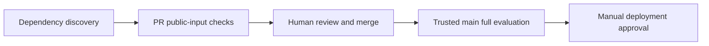

## CI/CD Reference

GitHub Actions automation for the nix-config repository. The pipelines handle
formatting, validation, compliance, security, and automatic flake lock updates.

______________________________________________________________________

### Introduction

Workflows that evaluate the flake or `nixosConfigurations` require access to
the private `nix-secrets` SSH flake input. Without the deploy key,
`nix flake check` fails because Nix cannot fetch the private repository.

Note: not every workflow that runs a `nix` command needs this key. `auto-format.yml`
runs `nix fmt` (formatting only, no evaluation), and `update-dashboards.yml` uses
`nix-hash` only — neither requires the SSH deploy key.

**Private-input credentials:** Full evaluation runs only for trusted `main`
(pushes, schedules and manual runs on `main`). PRs run parsing, classifier/gate
unit tests, and the public-input `security-boundaries` and `microvm-egress`
checks, including base/master Immich image contracts. They do not evaluate private host/user data or the full flake.

Before accepting this CI boundary, create a `trusted-main` GitHub environment,
restrict it to `main`, require independent reviewers, and move `SSH_DEPLOY_KEY`
and `PAT_TOKEN` into that environment. Remove their repository-wide copies.
Otherwise a same-repository collaborator can change a PR workflow to request a
repository secret directly, regardless of the conditions in this patch.
Environment jobs will need these secrets before full validation can work.
No external settings or credentials are changed by this repository patch.

The SSH deploy key should read only `nix-secrets`. `PAT_TOKEN` is used only by
lockfile discovery to open/update a PR; scope it to this repository's Contents
and Pull requests. Formatter and PR reporting jobs have read-only permissions,
disable checkout credential persistence, and publish reports to summaries or
artifacts. All executable action references are pinned to resolved full SHAs.

### Review and promotion

Lockfile automation opens update proposals. It does not enable auto-merge;
Copilot reviews are advisory. Human review must assess upstream provenance
and changes, since functional checks alone cannot establish dependency safety.
Blizzard's unattended upgrade is disabled. Merge, trusted full validation and
manual deployment are separate decisions.



______________________________________________________________________

### Full Workflow Reference

| Workflow | Trigger | Purpose | Auto-commits? |
|----------|---------|---------|--------------|
| `auto-format.yml` | PR / push to main / manual | Runs `nix fmt -- --fail-on-change` without write credentials | No |
| `flake-check.yml` | Every PR / push to main / manual / nightly 02:17 UTC | Classifies the complete diff; PRs run public-input checks, trusted main runs selected/full evaluation and lifecycle checks; preserves the `flake-check` gate | No |
| `validate-config.yml` | push to main / manual on main | Discovers hosts via `mkHost` grep, evaluates each host's `config.system.build.toplevel` with `nix eval` in a matrix, and evaluates the Home Manager users attrset | No |
| `change-impact-analysis.yml` | PR | Diffs changed files under `hosts/`, `modules/`, `home/`, `vms/`, `lib/`, `flake.*`, publishes an impact summary | No |
| `compliance-check.yml` | PR / push / cron Mon 09:00 | Runs `deadnix` and other Nix linters, uploads and summarizes results | No |
| `doc-drift.yml` | PR | Warns if code changes ship without any `docs/*.md` or `*.md` updates | No |
| `flake-freshness.yml` | cron Mon 08:00 / manual | Walks `flake.lock`, flags inputs older than 90 days via a GitHub Issue | No (opens Issue) |
| `health-check.yml` | cron daily 06:00 / manual | Discovers hosts, builds `config.system.build.toplevel` for each, opens or updates a bot-created infrastructure Issue on failure, and closes matching Issues after an authoritative recovery | No (opens, comments on, and closes Issues) |
| `security-audit.yml` | PR / push / cron Mon 02:00 / manual | Runs redacted `gitleaks` and fails on detection; audits firewall declarations | No |
| `update-nix-lock.yml` | cron every 3h / manual | Runs `update-flake-lock`, opens a PR for human review | Yes — lock file |
| `update-nix-lock-recreate.yml` | cron 1st of month 03:00 / manual | `nix flake update --recreate-lock-file`, opens a PR for human review | Yes — lock file |
| `update-dashboards.yml` | cron Mon 09:00 / manual | Polls Grafana.com API for new revisions of dashboards 1860 and 315, opens PR if newer revision found | No (opens PR) |
| `copilot-auto-merge.yml` | PR review submitted | Reports Copilot review status in the run summary; a human reviews and merges | No |

______________________________________________________________________

### Conditional Flake Check

Every PR and push to main creates the required `flake-check` gate; there are
no workflow-level path filters. The classifier uses the PR merge-base to head
diff, or the complete push before-to-after range. Rename detection is disabled
so both old and new paths contribute requirements, including deleted inputs.
Mixed changes select the union. Missing commits, invalid endpoints, or unavailable
history select the full suite. Manual dispatch and the nightly 02:17 UTC run
always select full coverage.

The dependency map lives in `.github/scripts/flake_ci.py`. It deliberately uses
exact filenames for configuration modules: new auto-loaded files default to
full coverage until their dependencies are reviewed. The executable contracts
under `.github/tests/` run before classification on every invocation.

| Changed inputs | Selected work |
|----------------|---------------|
| Markdown documentation | Formatting; no global output evaluation |
| Cloudflare collector, fixtures, dashboard, service module, or alerts | Cloudflare metrics and formatting |
| CrowdSec packages, Python fixtures, dashboard, monitoring, or contract definitions | CrowdSec HTTP/observability, three runtime fixtures, and formatting where applicable |
| CrowdSec service/security configuration | CrowdSec checks and fixtures, Matrix, publication, blackbox, network-policy, and formatting |
| Security-log archive module, package, host wiring, alerts, or fixtures | Archive sanitization/durability/protocol and alert checks, the two-VM archive runtime check, and formatting; CrowdSec producers also select archive checks |
| Matrix service modules and VM/storage files | Matrix baseline/WhatsApp, publication, blackbox, network-policy, and formatting |
| Jellyfin service/GPU/web modules and VM/settings files | Jellyfin firewall and MicroVM contracts, and formatting |
| Blackbox module, target configuration, or availability dashboard | Blackbox observability and formatting |
| Other existing check definitions | Their check and formatting |
| Lockfile, flake, treefmt, CI control scripts/tests/workflow, shared helpers/loaders/core/VM infrastructure, or any unmapped runtime file | Full suite |

On trusted main runs, every Nix file change retains global output evaluation, even when its check
builds are targeted. Documentation and mapped Python/fixture changes avoid that
global evaluation; building their selected checks still evaluates those checks'
dependencies. Unmapped non-Nix runtime changes also select full evaluation.
Formatting selection follows the current treefmt extensions and excludes
workflow YAML and lockfiles; a full run always builds formatting.

The `grouped` job first runs `evaluate-flake-outputs.sh` when selected. It keeps
each output evaluation in a separate Nix process to bound memory. It then builds
short checks sequentially on that runner for cache reuse. The
`microvm-lifecycle` check runs concurrently on its own runner whenever selected.
Its QEMU configuration and lifecycle coverage are unchanged.

Trusted full runs discover the current `checks.x86_64-linux` attribute names from Nix
and build every declaration, including future checks, formatting, and
`jellyfin-microvm`. Lifecycle is excluded from the grouped loop because its
separate job builds it. The Jellyfin MicroVM check evaluates assertions and
builds a marker; it does not boot a guest.

For CrowdSec selections, all grouped Nix builds and fixture preparation finish
with private-input SSH available. The workflow then stops the agent, clears its
credential environment, and runs all three Python runtime fixtures explicitly
without `SSH_AUTH_SOCK` or `SSH_AGENT_PID`. No later Nix work requires an agent
restart. Evaluation and Nix build failures pass diagnostics through
`redact-secrets.sh`; fixture preparation failures also propagate to the gate.

The final job remains named `flake-check` and uses `always()`. On PRs it
requires classifier success, a valid plan, success for `pr-static`, and skipped
private workers. On trusted runs it requires each selected private worker to
succeed; selected failures, cancellations, missing results and inconsistent
plans fail the gate. A green PR gate does not establish private-input evaluation.

The separate host and Home Manager matrix and daily health builds remain on
trusted main/manual runs. Formatting now fails if files would change and never
pushes corrections. Run `nix fmt` locally to prepare those corrections.

For local classifier and gate validation without Nix or the private input:

```bash
python3 -B -m unittest discover -s .github/tests -v
git diff --check
```

These tests cover real multi-commit Git histories, divergent PR bases, renames,
deletions, missing history, conservative selection, future check discovery, and
final-gate success/failure behavior. They do not validate Linux Nix evaluation,
builds, credentials, or runner behavior; use current CI for that evidence.
Parallelism may reduce wall time but can increase runner minutes. No timing
improvement has been measured for this workflow.

______________________________________________________________________

### Scheduled Workflows

These scheduled runs supplement event and manual triggers:

**Daily**

- **`flake-check.yml`** (02:17 UTC) — Full output evaluation and every declared
  check, with lifecycle on a separate runner and all three CrowdSec fixtures.

- **`health-check.yml`** (06:00) — Full host build to catch regressions that
  slipped through PR checks. On failure, opens an `infrastructure` / `urgent`
  GitHub Issue or comments on every matching open bot-created Issue. A successful
  run closes those Issues only when it tested the current default-branch head,
  after adding a recovery comment with the workflow-run link.

**Weekly (Monday)**

- **`flake-freshness.yml`** (08:00) — Opens a GitHub Issue listing any flake
  inputs that have not been updated in more than 90 days.
- **`compliance-check.yml`** (09:00) — Re-runs linters on the current main
  branch, not just on PRs.
- **`update-dashboards.yml`** (09:00) — Checks for upstream Grafana dashboard
  updates and opens a PR when a new revision is available.
- **`security-audit.yml`** (02:00) — Secret scanning and firewall hygiene check.

**Every 3 hours**

- **`update-nix-lock.yml`** — The primary lock-file automation. Uses
  DeterminateSystems/update-flake-lock@v28. Opens a PR only when inputs have
  actually changed. Human review and merge are required.

**Monthly (1st of month)**

- **`update-nix-lock-recreate.yml`** (03:00) — Regenerates the lock file from
  scratch (not just an incremental update), as a safety net for any inputs that
  the incremental updater might have pinned to a stale state.

______________________________________________________________________

### PR Workflows

These run on every pull request:

| Workflow | What it checks |
|----------|---------------|
| `auto-format.yml` | Checks formatting without committing or pushing |
| `flake-check.yml` | Runs public parsing, gate/classifier tests and isolated service/network security checks; always creates the required final gate |
| `validate-config.yml` | Private host evaluation runs only on trusted main/manual runs |
| `change-impact-analysis.yml` | Summarizes which layer (hosts, modules, home, vms, lib, flake) is affected |
| `compliance-check.yml` | Dead-code linting and other Nix hygiene checks |
| `doc-drift.yml` | Warns when code changes land without documentation updates |

Lockfile PRs require human review and merge. A new host extends the trusted
host-validation and health-check matrices, and still requires full validation
before deployment.

______________________________________________________________________

### Adding a New Host

When a new host is registered in `flake.nix` via `mkHost`, the CI matrix
workflows (`validate-config.yml`, `health-check.yml`, `update-nix-lock.yml`)
discover it automatically via a `grep mkHost flake.nix` step. No workflow file
edits are required.
